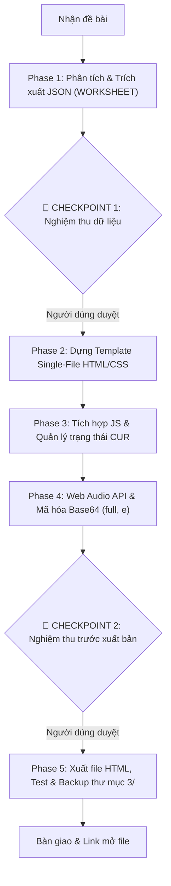

# Kỹ Năng Tạo Game Trắc Nghiệm Tương Tác Chuẩn `game-kit-antigravity-v2`

## 🎯 CÂU LỆNH KÍCH HOẠT (TRIGGERS)
- **Mặc định (Chế độ 5 Phase an toàn có nghiệm thu)**: 
  - *"làm game"*, *"tạo game"*, *"làm game mới"*, *"game-kit v2"*, hoặc gửi file đề bài (PDF, Word, ảnh, text)
- **Chế độ làm nhanh (Fast-track)**:
  - Thêm cờ `--fast-track`, *"làm nhanh"*, *"chạy tự động 1 mạch"* → AI tự động chạy liên hoàn 5 Phase và bàn giao sản phẩm ngay.

---

## ⚡ 5 NGUYÊN TẮC CỐT LÕI (BẤT BIẾN THEO RULES.MD V2)

1. **KIẾN TRÚC SINGLE-FILE HTML THUẦN (PORTABLE 100%)**:
   - Toàn bộ giao diện (HTML), định dạng (CSS trong `<style>`), dữ liệu và logic (JavaScript trong thẻ `<script>`) nằm trọn vẹn trong **MỘT FILE `.html` DUY NHẤT**.
   - Tuyệt đối không dùng jQuery, React, Vue hoặc kéo thư viện ngoài từ CDN.
   - Toàn bộ hình ảnh (WebP) và âm thanh bài nghe (MP3 mono 64kbps) đều được nhúng trực tiếp dạng **Base64 Data URI** (`data:image/webp;base64,...`, `data:audio/mp3;base64,...`). Tổng dung lượng file HTML luôn được tối ưu **< 2.5MB**.

2. **HIỆU ỨNG ÂM THANH BẰNG WEB AUDIO API (0KB EXTERNAL)**:
   - Sử dụng `window.AudioContext` tạo âm thanh tổng hợp (chime đúng `beep()`, còi sai `buzz()`, nhạc chiến thắng `fanfare()`) qua Oscillator thuần. Không phụ thuộc bất kỳ file âm thanh hiệu ứng rời nào.

3. **CẤU TRÚC DỮ LIỆU TẬP TRUNG & CHỐNG GIAN LẬN BASE64**:
   - **Data-Driven**: Toàn bộ dữ liệu đề thi được cô lập vào hằng số `const WORKSHEET = { ... };` ở đầu thẻ `<script>`.
   - **Centralized State**: Gom toàn bộ trạng thái chạy (câu hỏi, điểm số, thời gian, thông tin học sinh) vào `let CUR = { ... };`.
   - **Anti-Cheat Base64**: Bắt buộc mã hóa Base64 cho trường đáp án đúng (`full`) và giải thích (`e`) bằng `btoa()`, giải mã bằng `atob()` khi hiển thị kết quả.

4. **BẮT BUỘC NHẬP TÊN HỌC SINH & BẢNG VÀNG VIP CERTIFICATE**:
   - Tích hợp chuẩn `game-mandatory-student-name`: Modal chào mừng chặn bắt đầu bài thi nếu học sinh chưa điền họ tên, lưu trữ `localStorage`, hiển thị pill đổi tên ở góc trên và in tên trang trọng vào Bảng vàng VIP Certificate khi hoàn thành.

5. **CHUẨN HÓA 4 ĐÁP ÁN (A/B/C/D) & ĐỌC HIỂU SPLIT VIEW**:
   - Cân bằng tỷ lệ đáp án đúng A/B/C/D đồng đều (~25% mỗi vị trí), không để dồn cục.
   - Bài đọc hiểu dài áp dụng cấu trúc `passage` với Split View (khung bài đọc cố định song song câu hỏi), tránh lặp lại đoạn văn.

---

## 🛠️ WORKFLOW HỖ TRỢ XỬ LÝ ĐỀ PDF TOÀN ẢNH & AUDIO RỜI
Khi người dùng gửi **đề dạng PDF toàn ảnh scan/chụp** + **file nghe rời**, sử dụng bộ công cụ hỗ trợ tại `game-kit/workflow/`:
1. **Xuất các trang PDF ra ảnh độ phân giải cao**:
   - `pdftoppm -r 100 -png de.pdf $WORK/pages/p` (xem nội dung & toạ độ 100dpi)
   - `pdftoppm -r 200 -png de.pdf $WORK/hi/p` (cắt ảnh sắc nét gấp đôi)
2. **Phân tích Audio**:
   - Quét tìm file `.mp3` có sẵn hoặc chạy `python workflow/asr.py '*Part_4*.mp3'` hoặc `build_game.py --suggest-marks` để lấy bản chép lời thô và mốc giây.
3. **Viết script generator tự động với `game-kit/workflow/common.py`**:
   - `u.crop(...)`, `u.grid(...)`, `u.quad(...)`: xử lý cắt và ghép ảnh.
   - `place(dung, [sai1, sai2, sai3])`: tự động xáo trộn và phân bổ đều 4 đáp án A, B, C, D (~25%).

---

## 🚦 QUY TRÌNH 5 GIAI ĐOẠN & 2 CHECKPOINT KIỂM SOÁT



> **Lưu ý**: Nếu người dùng yêu cầu `--fast-track`, AI sẽ tự động vượt qua Checkpoint 1 và 2 để hoàn thiện trực tiếp đến Phase 5, sau đó báo cáo tổng thể.

### 📋 CHI TIẾT TỪNG PHASE:

#### 🔹 Phase 1: Phân tích Dữ liệu & Xây dựng Cấu trúc JSON (`WORKSHEET`)
- Trích xuất toàn bộ câu hỏi, bài đọc, tranh ảnh và audio từ tài nguyên nguồn.
- Chuẩn hóa về 4 lựa chọn (A/B/C/D), phân bổ vị trí ngẫu nhiên đều ~25%.
- Xây dựng schema `WORKSHEET`:
  ```javascript
  const WORKSHEET = {
    title: "TIÊU ĐỀ BÀI KIỂM TRA",
    tag: "Khối lớp · Tên bài",
    settings: { secondsPerQuestion: 90, basePoints: 100, maxSpeedBonus: 50 },
    sections: [
      {
        id: "part1",
        title: "Part 1. Listening / Multiple Choice",
        items: [
          {
            prompt: "1. Câu hỏi mẫu?",
            options: ["A. Đáp án 1", "B. Đáp án 2", "C. Đáp án 3", "D. Đáp án 4"],
            full: btoa("A. Đáp án 1"), // Mã hóa Base64
            e: btoa("Giải thích chi tiết tại sao chọn A.") // Mã hóa Base64
          }
        ]
      }
    ]
  };
  ```
- **🛑 DỪNG LẠI TẠI CHECKPOINT 1**: Cập nhật `STATE.md` (đánh dấu `[x] Phase 1`), trình bày tóm tắt cấu trúc câu hỏi và xin ý kiến phê duyệt của người dùng trước khi tiến hành code giao diện.

#### 🔹 Phase 2: Khởi tạo Template HTML/CSS (Single-file)
- Xây dựng cấu trúc HTML sạch, ngữ nghĩa, tối ưu responsive trên mọi thiết bị.
- CSS hiện đại đặt hoàn toàn trong thẻ `<style>`: giao diện Sky Blue trang nhã, thẻ câu hỏi trực quan, thanh ray tiến độ, nút bấm lớn thân thiện với học sinh.
- Modal đăng ký tên học sinh bắt buộc (`game-mandatory-student-name`).

#### 🔹 Phase 3: Tích hợp Dữ liệu vào JavaScript & Xử lý Logic
- Khai báo `let CUR = { ... }` quản lý tập trung:
  - `studentName`: Tên học sinh (lưu `localStorage`)
  - `sectionIdx`, `itemIdx`: Vị trí câu hỏi hiện tại
  - `score`, `streak`, `timer`: Điểm số, chuỗi đúng và đếm ngược thời gian
  - `answers`: Lịch sử câu trả lời của học sinh
- Xử lý tương tác: chọn đáp án, tính điểm thưởng tốc độ, hiển thị giải thích ngay khi chọn xong.

#### 🔹 Phase 4: Web Audio API & Hoàn thiện Mã hóa Base64
- Khởi tạo `AudioContext` khi người dùng tương tác lần đầu (click chuột/chạm).
- Tích hợp bộ tạo sóng Oscillator (`beep`, `buzz`, `fanfare`).
- Nhúng toàn bộ tài nguyên đa phương tiện (ảnh WebP, audio bài nghe MP3 64k) dạng Data URI trực tiếp vào file.
- **🛑 DỪNG LẠI TẠI CHECKPOINT 2**: Cập nhật `STATE.md` (đánh dấu `[x] Phase 2, 3, 4`), tóm tắt dung lượng file và thông báo sẵn sàng xuất bản.

#### 🔹 Phase 5: Xuất File HTML Hoàn chỉnh, Test & Sao lưu
- Xuất file HTML duy nhất ra thư mục làm việc: `<Ten_File_Game>.html`.
- Tự động sao lưu 1 bản vào thư mục `3/`:
  ```powershell
  Copy-Item "<Ten_File_Game>.html" -Destination "3/<Ten_File_Game>.html" -Force
  ```
- Chạy kiểm tra chất lượng (Quality Check):
  - Kích thước file `< 2.5MB`.
  - Không có lỗi cú pháp JavaScript.
  - Toàn bộ đáp án giải mã `atob()` chính xác.
- Đánh dấu hoàn tất `[x] Phase 5` trong `STATE.md` và bàn giao link mở file cho người dùng.
